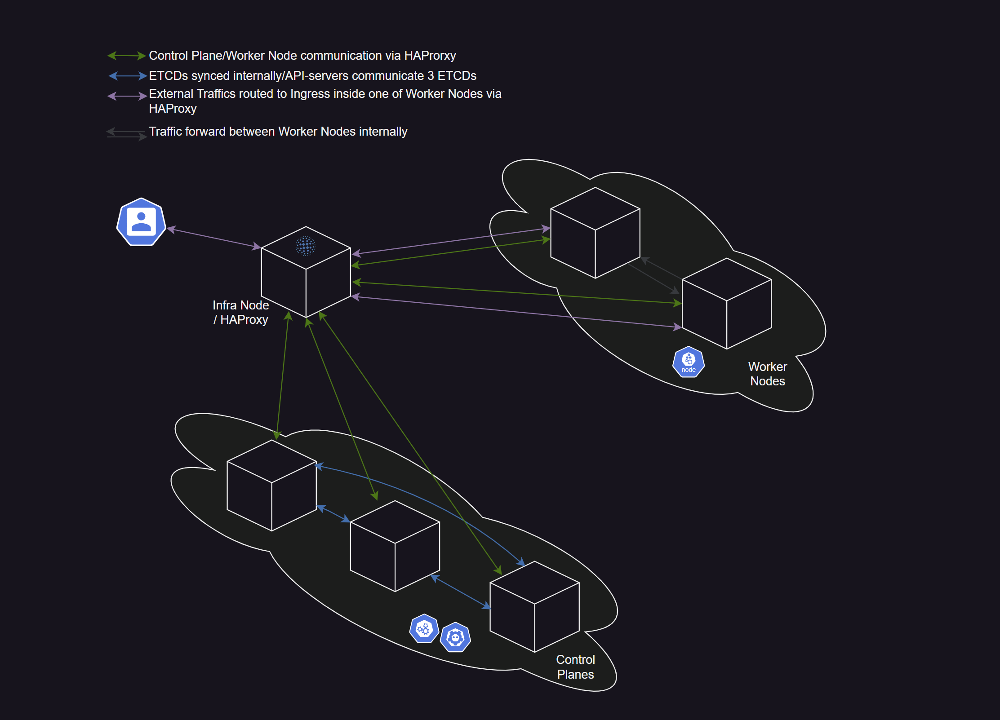

# k8s-infra-setup.ubuntu
Kubernetes infrastructure Setup for Ubuntu

## Introduction

This package is to support the following tasks:

- Environment setup and the supported package installation.
- Container Runtime Interface (CRI) installation.
- Kubernetes package installation.
- Cluster setup for the single or multi master nodes as welll as worker nodes.
- Add-ons installation.

## Goal

The package is to demostrate the the cluster setup in the following setup:

- single master/control plane with/without one or more worker nodes
- multi masters/control planes with/without one or more worker nodes

The example of the multi masters and multi workers that configured by this package:

## Platform to be supported

The on-prem solution provides the wild range of the enviuronments such as:
- VirtualBox
- Kernel-based Virtual Machine (KVM)
- others

## Tested Kubernetes versions

This setup has been tested with the following Kubernetes released versions:

- 1.36.x

